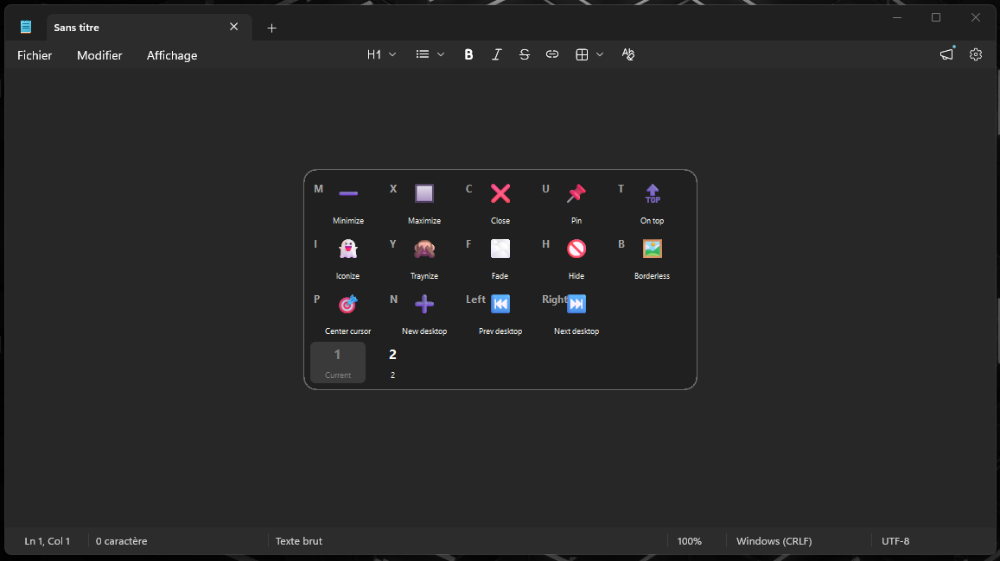
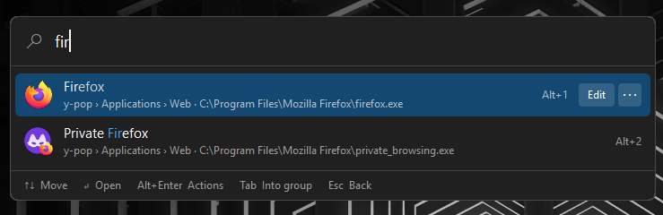
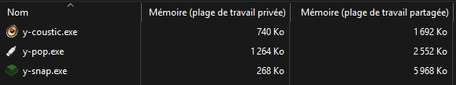
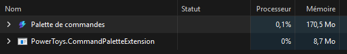

# Ypo-Lite

**Small native Windows tray tools, written in Rust. Each one is a single
executable of a few hundred kilobytes, with no runtime, no background service
and nothing injected into your other programs.**

<p align="center">
    <picture>
        
    </picture>
</p>

|  |  |
| --- | --- |
|  |  |
| **Y-Snap**: move, resize, roll up, fade or pin the window under your pointer | **Y-Pop**: launch anything from tray menus, or by typing a few letters |

<!-- Replace with a short GIF of Y-Snap once recorded, see docs/design/media-shots.md -->

## Why Ypo-Lite

- **Light.** Each tool is one `.exe` of a few hundred kilobytes that sits in the
  notification area and does its job. While running, Y-Snap holds about 0.3 MB
  of private memory, Y-Pop 1.3 MB and Y-Coustic 0.7 MB ([measured](#memory)).
- **Nothing to carry around.** No installer is required: drop the executable and
  its one XML file on a USB stick and go. Settings are plain text you can read,
  diff and version.
- **Works with what you already do.** Tools act on the window under your
  pointer, or on the program you type the name of. No clicking things into
  focus first.
- **Safe by design.** Low-level keyboard and mouse hooks never allocate, lock or
  wait on another process, so a hook cannot freeze your input. A bad line in a
  config file costs you that one setting, never the whole file.
- **Open source.** GPL-3.0-or-later, built by a CI workflow, with signed
  commits and releases carrying SHA-256 checksums and build attestations.

Ypo-Lite is the Rust rewrite of the [GUIPro](http://glatigny.github.io/guipro/)
utilities (PortAL, HulK, VulCan, ...), keeping what made them useful and
leaving out the DLL plugins and the legacy.

### Memory

What Windows reports for the three tools once they are running and idle, next to
PowerToys' Command Palette, a launcher with a comparable job to Y-Pop's search:

| | |
| --- | --- |
|  |  |
| **Ypo-Lite**, private / shared: Y-Snap 0.27 / 5.97 MB, Y-Pop 1.27 / 2.56 MB, Y-Coustic 0.74 / 1.70 MB | **PowerToys**: Command Palette 170.5 MB, plus 8.7 MB for its extension system |

These are the private and shared working sets Windows reports on one machine,
not a benchmark. Private memory is what a tool alone costs; shared memory is
mostly Windows' own libraries, mapped once for every program that uses them.
The programs do not do exactly the same things. Command
Palette is built on a UI framework and an extension system, which Ypo-Lite
leaves out on purpose.

## The tools

| Tool | What it does | Rewrite of | State |
| --- | --- | --- | --- |
| **[Y-Snap](y-snap/README.md)** | Window management by hotkey, mouse gesture and overlay: move and resize from anywhere inside a window, minimize, maximize, roll up, fade, strip the frame, hide behind a tray icon, pin to every virtual desktop or send to another one or to another monitor | HulK | Usable |
| **[Y-Pop](y-pop/README.md)** | A tray icon whose menu launches your programs, and a search window that finds them as you type | PortAL | Usable |
| **[Y-Coustic](y-coustic/README.md)** | Volume manager: steps or mutes the master volume, the microphone and any application from hotkeys, the mouse wheel and the tray icon, with a small on-screen bar | VulCan | Usable |

Each tool is configured through one XML file.
[`y-snap-config`](y-snap-config/README.md),
[`y-pop-config`](y-pop-config/README.md) and
[`y-coustic-config`](y-coustic-config/README.md) are the WinUI 3 settings apps that
edit those files, if you would rather not edit them by hand. Their manuals:
[y-snap-config](y-snap-config/docs/user-manual.md),
[y-pop-config](y-pop-config/docs/user-manual.md) and
[y-coustic-config](y-coustic-config/docs/user-manual.md).

## Install

Ypo-Lite needs Windows 10 or 11 (x64). Download one of these from the
[latest release](https://github.com/ypo-lite/ypo-lite/releases/latest):

- **The installer**, `ypo-lite-setup-<version>.exe`. It installs for your user
  only, without administrator rights, and lets you pick the tools. It adds a
  default configuration, and downloads the Windows App Runtime (about 125 MB)
  if the settings apps need it.
- **The portable zip**, `ypo-lite-<version>-x64.zip`. Extract it to a folder of
  your own and run `y-snap.exe`, `y-pop.exe` or `y-coustic.exe`; each one appears in the
  notification area. The configuration files stay next to the executables.

The settings apps need the
[Windows App Runtime](https://learn.microsoft.com/windows/apps/windows-app-sdk/downloads)
2.4 or later. If you use the zip and it is missing, they offer to open that
page. Y-Snap, Y-Pop and Y-Coustic don't need it.

### Trust and verification

The executables and the installer are signed with the project's own self-signed
certificate, `CN=Ypo-Lite`, published as
[`installer/ypo-lite-signing.cer`](installer/ypo-lite-signing.cer). No public
authority has vouched for it, so Windows still reports the publisher as unknown
and SmartScreen may warn you the first time you run them. Each release lists
SHA-256 checksums, and `gh attestation verify <file> --repo ypo-lite/ypo-lite`
confirms a file was built by this repository's release workflow.

### Where the configuration lives

Each tool uses the first of these that exists:

1. the path given with `-config <file>` on the command line;
2. `y-snap.xml`, `y-pop.xml` or `y-coustic.xml` next to the executable, which keeps a copy
   portable;
3. `%APPDATA%\Ypo-Lite\`.

## Build from source

You need [Rust](https://rustup.rs/) 1.95 or later with the MSVC toolchain, and
the Windows SDK for its resource compiler.

```sh
cargo build --release    # executables in target/release
cargo test --workspace
cargo run -p y-snap      # debug run of one tool
```

## Contributing

Bug reports, ideas and pull requests are welcome. Read
[CONTRIBUTING.md](CONTRIBUTING.md) first: it covers the house rules for the
code, how to build and test, and what a pull request needs to be merged.

## Repository layout

| Path | Content |
| --- | --- |
| `y-snap`, `y-pop`, `y-coustic` | the tools |
| [`y-snap-config`](y-snap-config/README.md), [`y-pop-config`](y-pop-config/README.md), [`y-coustic-config`](y-coustic-config/README.md) | their WinUI 3 settings apps ([manual](y-snap-config/docs/user-manual.md), [manual](y-pop-config/docs/user-manual.md), [manual](y-coustic-config/docs/user-manual.md)) |
| `y-term` | placeholder for the next tool |
| [`core`](core/README.md) | shared Win32 plumbing: tray icon, hotkeys, overlays, menus, configuration |
| [`ui-kit`](ui-kit/README.md) | the WinUI toolkit shared by the settings apps ([guide](ui-kit/docs/ui-toolkit.md)) |
| [`skeleton`](skeleton/README.md) | a self-contained reference application, with the Win32 rationale behind `core` |

If you want to write a Win32 tray utility in Rust yourself, `skeleton` and
`core` are meant to be read: the rationale for each design choice is written
down.

## License

[GPL-3.0-or-later](LICENSE).
