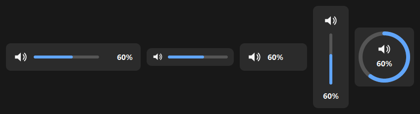
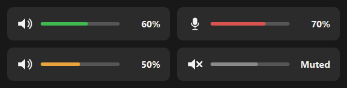

# y-coustic

**The volume, one keystroke, one wheel turn away.** y-coustic lives in the
notification area. It steps or mutes the master volume, the microphone and any
application's volume from the hotkeys, the mouse wheel and the tray icon you
choose, and shows where the level went on a small bar, the HUD, on the screen
you are looking at.

It is the rewrite of *VulCan*. The [design](docs/design/y-coustic-plan.md) says
why, the [implementation plan](docs/design/implementation-plan.md) says what is
built.

<!-- Add once taken, see docs/screenshots.md:

-->

<!-- Add once recorded, see docs/screenshots.md:

-->

## What it does

- **Master, microphone and applications.** Volume up, down, mute, or a fixed
  level, for the default output, the default microphone, the application in front
  or the one under the pointer. Layers put a modifier key on the same keys:
  `Shift` for the microphone, `Ctrl` for the focused application.
- **The mouse wheel.** `Alt` + wheel for the master, `Alt` + `Shift` + wheel for
  the microphone, a middle click to mute; over a window, the wheel can drive that
  application's own volume.
- **The HUD.** A bar, a tall bar, a ring, a number or a compact icon, in the
  light or dark theme or your own colours, with a different accent per kind so a
  live microphone is never mistaken for the master. It can be used with the
  pointer: wheel, click, drag, a click on its icon to mute.
- **The mixer.** `Win` + `Alt` + `V` opens one window with every volume,
  playing or not: arrows, digits, wheel and mouse.
- **The tray icon.** Rest the pointer on it and the HUD shows the master level;
  turn the wheel over it to change it; click, double-click and middle-click can
  each do what you choose. The icon itself can follow the microphone's mute state.
- **Follows what happens outside.** The Sound panel, a laptop's microphone key or
  another device becoming the default are noticed, and the microphone's mute can
  be announced.
- **Light.** One native executable, no runtime, no service, and it gives its
  memory back after each event.
- **Portable.** Drop `y-coustic.xml` next to `y-coustic.exe`. With no file at
  all, the defaults apply.

## Quick start

1. Run `y-coustic.exe`. An icon appears in the notification area. If it is in
   the overflow flyout, drag it onto the taskbar: the hover on the icon needs it.
2. Press `Win` + `NumAdd` or `NumSub` to change the volume, `Win` + `Numpad0` to
   mute, or hold `Alt` and turn the wheel.
3. Press `Win` + `Alt` + `V`, or click the icon, for the mixer.
4. Right-click the icon for the menu: **Configuration** (**Settings…**, **Edit
   y-coustic.xml**, which creates the file if there is none, **Reload
   configuration**, **Start with Windows**), **About**, **Exit**.

<!-- Add once taken, see docs/screenshots.md:

-->

## Make it yours

Everything is in one commented XML file, `y-coustic.xml`: the keys and layers,
the mouse bindings, what the tray icon does on each click, the HUD's style,
position, colours and fade.

Or change it in the settings app, `y-coustic-config.exe` (*Settings…* in the tray
menu): one screen each for the general options, the keys and their layers, the
mouse, the tray icon, the mixer, the HUD (with a preview) and the colours. It
keeps your comments and saves nothing that y-coustic cannot read.

## Documentation

- [User manual](docs/user-manual.md)
- [Configuration reference](docs/configuration.md)
- [Development notes](docs/development.md)
- [Pictures still to take](docs/screenshots.md)
- [Design](docs/design/y-coustic-plan.md) and
  [implementation plan](docs/design/implementation-plan.md)

Building the workspace is on the [main page](../README.md#build-from-source).
