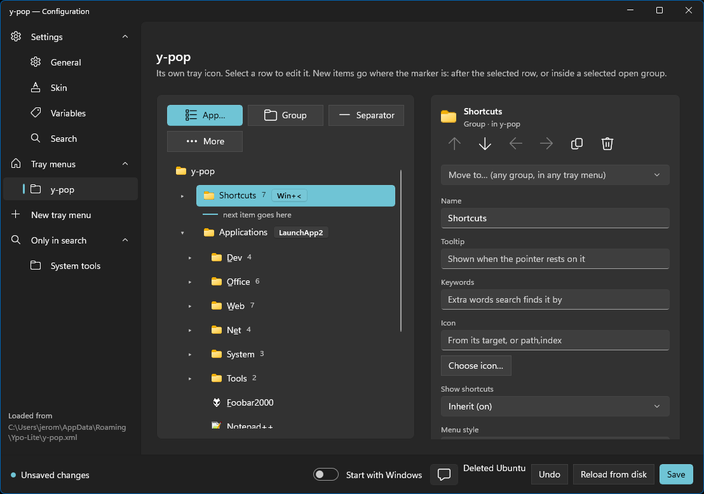

# Y-Pop-config

The settings app of [Y-Pop](../y-pop/README.md): a WinUI 3 editor for `y-pop.xml`.
Build each tray menu as a tree by adding apps from the Start menu, the Store or
Explorer (or by dropping them in), and set the skin, the variables and the search
window with a live preview. When you save, a running y-pop applies the change at
once.



## Use it

Choose **Settings…** in a y-pop tray menu that has a `<settings/>` entry, or type `>`
in the search window and choose **Open settings**. `y-pop-config.exe` sits next to
`y-pop.exe`; only one window opens at a time.

Saving keeps the comments and the blank lines of `y-pop.xml`, and writes variables
as you typed them (`%win%\notepad.exe` stays that way).

## Documentation

| | |
| --- | --- |
| [User manual](docs/user-manual.md) | every page of the app, with screenshots |
| [Configuration reference](../y-pop/docs/configuration.md) | every setting of `y-pop.xml` |
| [`design/`](docs/design/) | specification, plan, UI checklist and mockup |
| [UI toolkit](../ui-kit/docs/ui-toolkit.md) | the shared `ui-kit` the screens are built from |

## Build

```sh
cargo run -p y-pop-config
```

Built on [`windows-reactor`](../docs/design/windows-reactor.md) and `ui-kit`, part of
[Ypo-Lite](../README.md).
