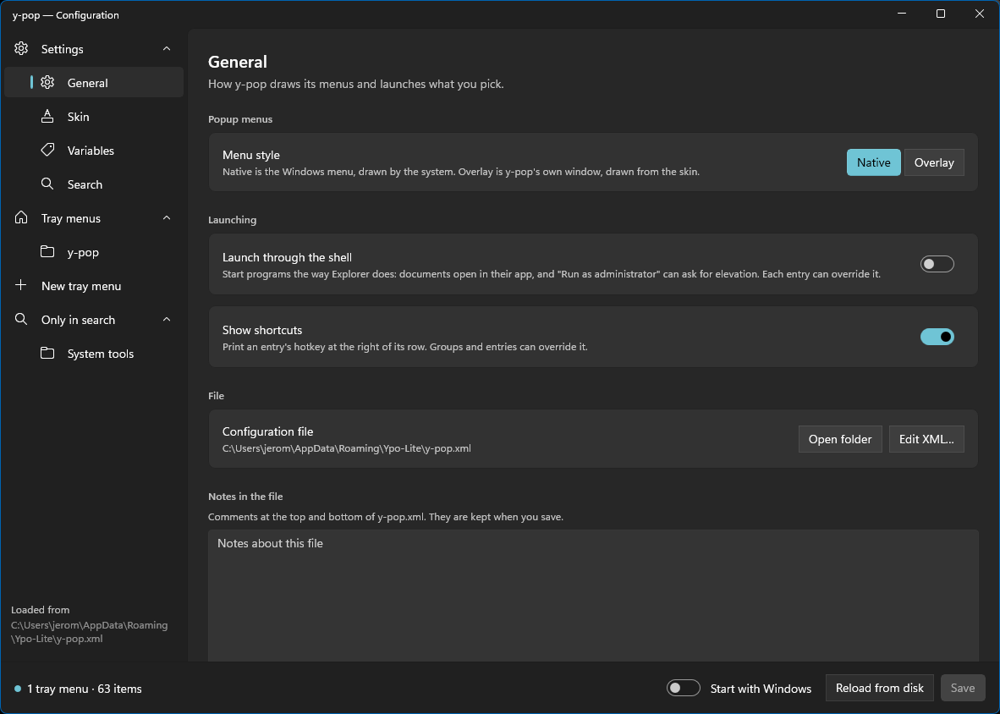
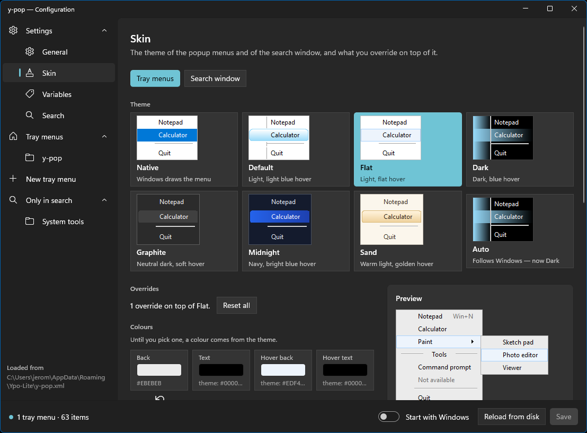
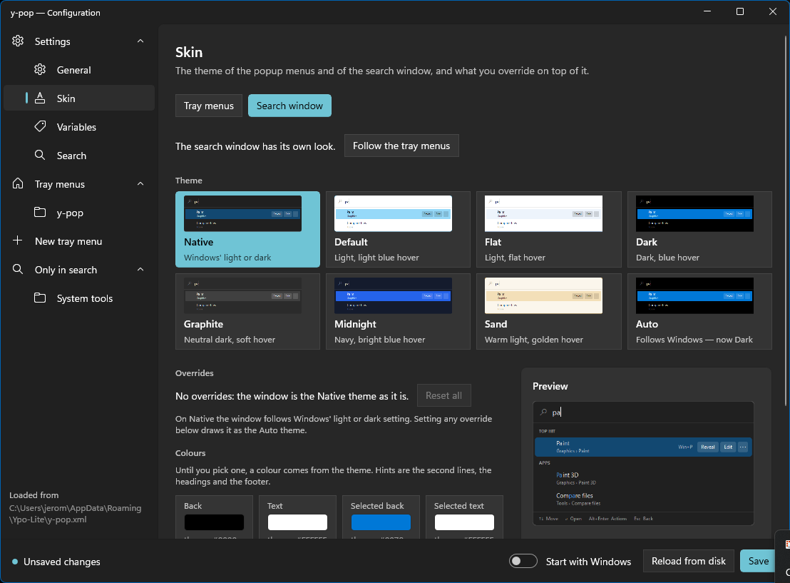
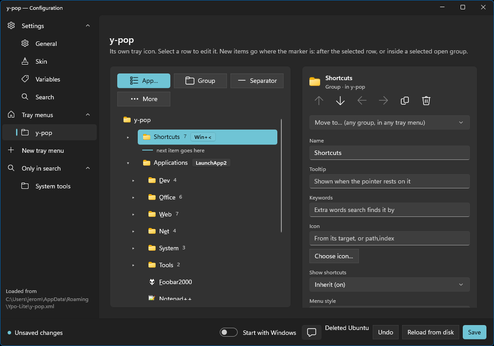
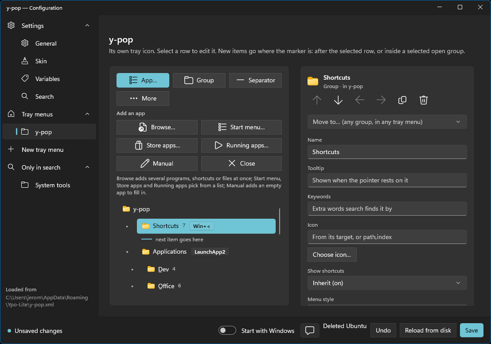
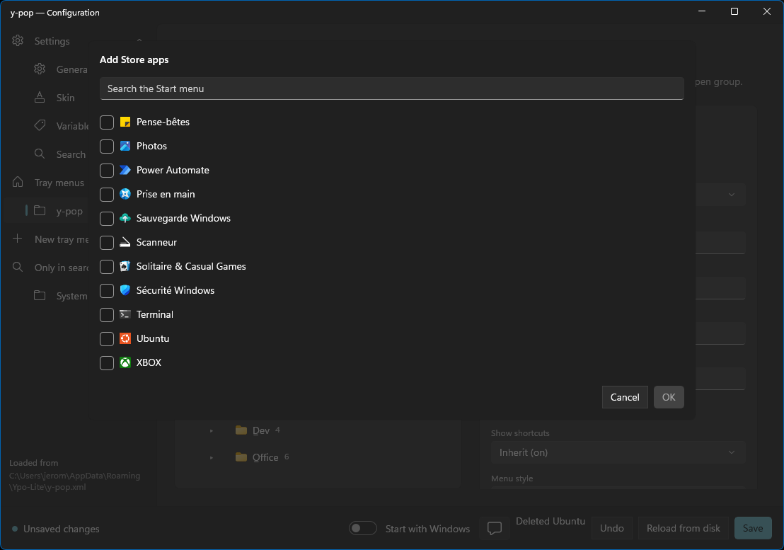
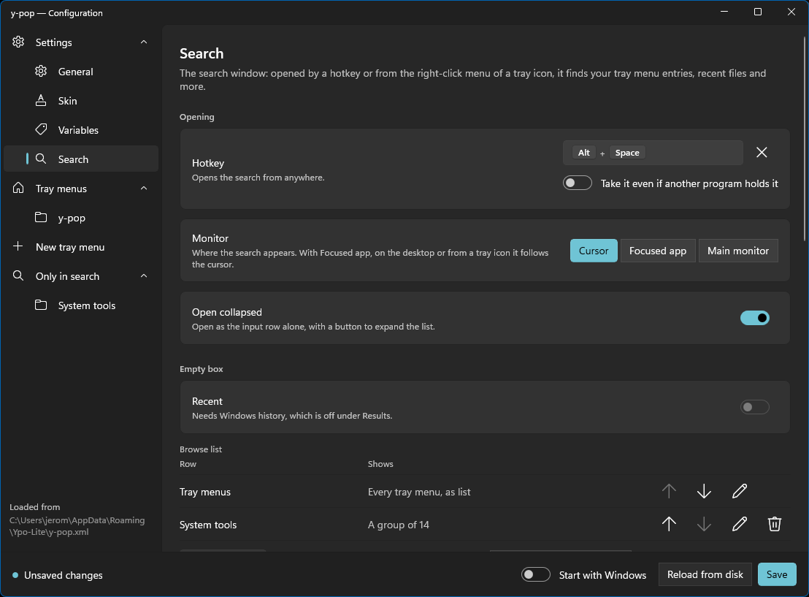
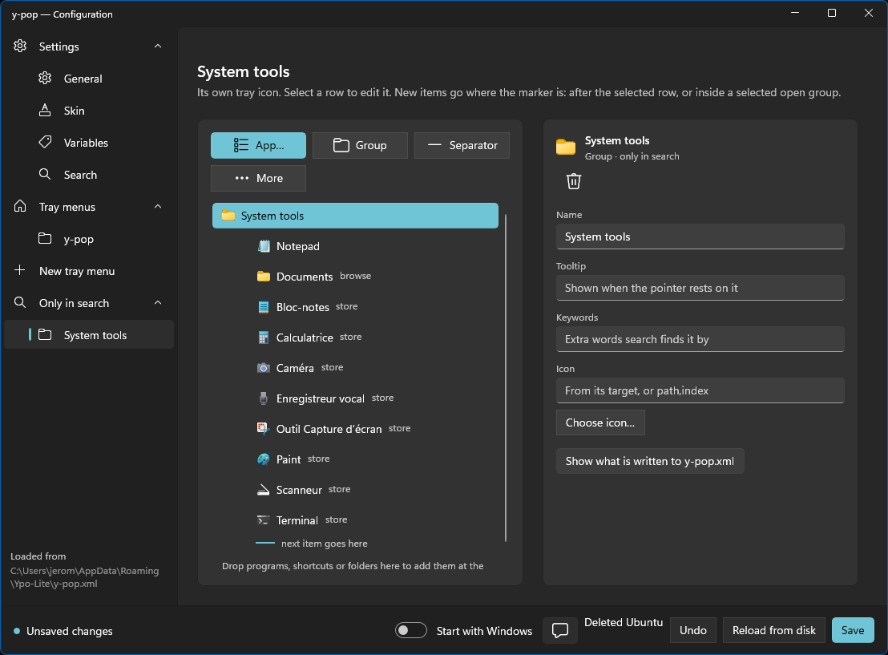

# y-pop-config — user manual

y-pop-config is the settings app of [y-pop](../../y-pop/README.md). It edits
`y-pop.xml` for you: how the menus look and launch things, the variables you use in
paths, every tray menu as a tree you build by adding and dropping, and the search
window. When you save, a running y-pop applies the change at once.

Everything the app edits is also in the file, and the
[configuration reference](../../y-pop/docs/configuration.md) describes it attribute
by attribute. This manual is about the app.

- [Opening it](#opening-it)
- [The window](#the-window)
- [General](#general)
- [Skin](#skin)
- [Variables](#variables)
- [Tray menus](#tray-menus)
  - [Adding items](#adding-items)
  - [Editing an item](#editing-an-item)
  - [Moving and deleting](#moving-and-deleting)
  - [Icons](#icons)
- [Search](#search)
- [Only in search](#only-in-search)
- [Saving, and what is kept](#saving-and-what-is-kept)
- [Command line](#command-line)
- [Troubleshooting](#troubleshooting)

---

## Opening it

Choose **Settings…** in a tray menu that has a `<settings/>` entry, or, in y-pop's search window, type `>` and choose **Open settings**. The *Edit* action of
a search result opens it on that item. The app is `y-pop-config.exe`, in the same
folder as `y-pop.exe`; it also starts on its own, with or without y-pop running.

Only one window is ever open: starting it again brings the open one forward.

---

## The window

- **The list on the left** has two sections that fold away. **Settings** holds
  *General*, *Skin*, *Variables* and *Search*. **Tray menus** holds one entry for
  each tray icon of your `y-pop.xml`, with its own icon, then **New tray menu**.
  **Only in search** lists the groups and folders that only the search window sees
  (see [below](#only-in-search)). On a narrow window the list shrinks to icons, and
  the sections open as flyouts.
  Below the list, *Loaded from* shows which `y-pop.xml` is being edited.
- **The status bar at the bottom** says whether the file is saved, and counts tray
  menus and items. Its buttons:
  - **Start with Windows** registers y-pop to start when you sign in. It applies at
    once, and does not wait for Save.
  - A message about the last thing you did, such as *Deleted Ubuntu*, with **Undo**.
  - **Reload from disk** reads `y-pop.xml` again.
  - **Save**, available once something has changed.
- **Warnings.** If the file has something y-pop could not understand, a banner above
  the page lists it. y-pop ignores it, and saving removes it from the file.

---

## General

How y-pop draws its menus and launches what you pick.

| Setting | |
| --- | --- |
| **Menu style** | *Native* is the Windows menu, drawn by the system. *Overlay* is y-pop's own window, drawn from the skin. With *Overlay*, an **Overlay layout** appears: *List* is built; *Runner* and *Radial* are greyed out and marked *Coming later*, so the file never holds a value that only produces a warning. |
| **Launch through the shell** | Starts programs the way Explorer does: documents open in their own app, and *Run as administrator* can ask for elevation. Each entry can override it. |
| **Show shortcuts** | Prints an entry's hotkey at the right of its row. Groups and entries can override it. |
| **Configuration file** | The path of `y-pop.xml`, with **Open folder** and **Edit XML…**. |
| **Notes in the file** | The comments at the top and bottom of `y-pop.xml`, as one text box. They are kept when you save. |

---

## Skin

The look of the popup menus and of the search window. The **Tray menus** and
**Search window** buttons at the top switch between the two.

**Theme.** One card for each theme, drawn as a small menu in that theme: *Native*
(Windows draws the menu), *Default*, *Flat*, *Dark*, *Graphite*, *Midnight*, *Sand*,
and *Auto*, which follows the Windows light or dark mode and says which one it is now.

**Overrides.** Everything below the cards changes one thing on top of the theme. A
line says how many overrides there are, with **Reset all**. Nothing you leave empty
is written to the file: it comes from the theme.

| | |
| --- | --- |
| **Colours** | *Back*, *Text*, *Hover back*, *Hover text*, and the colour of disabled entries. Each shows the theme's value until you pick one, with a button to go back to it. |
| **Spacing** | The space between rows, and inside a row, in pixels. |
| **Edge rule** | A vertical rule between the icons and the text: the theme's, on rows that are not hovered, on the hovered row, or on every row. |
| **Separator line** | Where the line of an untitled separator starts: after the icons, or the full width. |
| **Border** | Width, corner radius and colour of the outline. |
| **Background gradient** | A gradient on the hovered row, horizontal or vertical. |
| **Icon column gradient** | A gradient on the icon column of the rows that are not hovered. |

The border and the two gradients have a switch of their own, since they are written
whole or not at all.

**Native** cannot be themed, because the Windows menu draws itself. Its overrides
are greyed out. Setting one switches to *Auto* and draws the menu in y-pop's own
window, as y-pop does when it reads such a file.

**Preview.** A menu drawn with the settings as you edit them: a hovered row, an
open submenu, a disabled row and a titled separator.

**The search window** follows the tray menus' look by default. **Give it a look of
its own** chooses a theme and overrides for the search window alone, and *Follow the
tray menus* goes back. Its preview is the search window, with a query typed in. With
the *Native* theme it follows Windows' light or dark setting; setting any override
draws it as *Auto*.

---

## Variables

Names you can use as `%name%` in any path or text of the file. A variable sees the
built-in ones and the variables *above* it, so the order matters.

**Your variables** is a table of *name*, *value*, what the value **resolves** to on
this machine, and how many items use it. **Add variable** adds a row, and the arrows
reorder. Renaming a variable renames it in every item that uses it; deleting one
that is still used warns you first.

**Built in** lists the variables y-pop always has, read-only, with their value on
this machine: `%pop%` (the folder of `y-pop.exe`), `%win%`, `%system%`,
`%programfiles%`, `%mydocs%`, `%desktop%`, `%appdata%` and the others.
`%clipboard%` and `%clipboards%` are read when an item launches, not before.

---

## Tray menus

Each tray icon of the file has a page of its own: a group is a tray icon with a menu,
and a single app is a tray icon that launches on a click. **New tray menu** adds one.

The page is in two parts. On the left, the menu as a tree, as it will look: icon,
name, hotkey, the number of entries in a group, separators as lines, a column break as
a marker. A chevron folds a group. On the right, the **inspector** edits the selected
row. On a narrow window the inspector goes under the tree.

### Adding items

**The selection is the insertion point.** A line reading *next item goes here* shows
where the next item will land: right after the selected row, or at the end of a
selected open group. You build a menu from top to bottom, without reordering it
afterwards.

The toolbar above the tree adds:

- **App…** opens the app picker, below.
- **Group** adds a submenu.
- **Separator** adds a line.
- **More** adds a *Titled separator*, a *Folder (browse)*, a *Column break*, and the
  *About*, *Quit* and *Settings* entries.

**The app picker** adds one or several apps at once:

| | |
| --- | --- |
| **Browse…** | Pick programs, shortcuts or files with the file dialog. |
| **Start menu…** | A searchable list of the Start menu's programs, with icons. Tick several. |
| **Store apps…** | The installed Store apps. Tick several. |
| **Running apps…** | The programs behind the windows open now. |
| **Manual** | An empty app to fill in. |

Each list has a search box, and a *Show more* button when it is long. The title says
how many items are ticked, and **OK** adds them all at the insertion point.

**Drag and drop.** Drop programs, shortcuts or folders from Explorer on the tree.
Dropped on a group, they go inside it; dropped on another row, right after it; dropped
on the empty part, at the marker. A program takes its name from its file description.
A shortcut (`.lnk`) runs what it points at, with its arguments, working folder and
icon. A folder becomes an entry listing its contents as a submenu. Paths are written
with variables where one fits, such as `%system%\notepad.exe`.

A dropped item is added and selected at once. A strip above its fields says *Created
from …* and offers the alternatives in one click: *Use its target* or *Keep as
shortcut* for a shortcut, *Open the folder* or *Show as submenu* for a folder, and
*Use absolute path* or *Use variables* for the path.

### Editing an item

The inspector's fields depend on the kind of item.

**All items.** *Name*, *Tooltip* (shown when the pointer rests on it), *Keywords*
(extra words the search window finds it by), and *Icon*.

**A group** adds *Hotkeys*, *Default item* (shown in bold), *Show shortcuts* and
*Menu style*, each of which can *Inherit* the value of General. A group that is a tray
icon also has **Open when the pointer rests on its tray icon**.

**An app** has these sections:

- **Target.** *Program or file*, *Folder as submenu* or *Store app*, with **Browse…**
  and **Insert variable…**. Under the path, y-pop-config suggests a shorter spelling
  with a variable (*Could be written `%win%\…`*), and **Use it** applies it.
- **Launch.** *Arguments*, which can use `%clipboard%` and `%clipboards%`; *Start in*,
  the working folder; **Launch through the shell**, which can inherit General's
  setting; **Run as administrator**; and **Also run when y-pop starts** and **when
  y-pop exits**.
- **Folder listing**, for a folder: a *Filter* (such as `*.sln;*.csproj`), a *Depth*
  from 0 (files only) to 200, the *Entry to open the folder itself* (in every
  submenu, only at the deepest level, or never), and **Search inside it with /**,
  which also indexes a network share.
- **Hotkeys.** **Add hotkey** opens the key picker. Each hotkey has an *Override*
  switch, to take the combination even if another program holds it.
- **Test.** **Run now** starts the item exactly as y-pop would, with what is on the
  clipboard now. The result shows in the status bar.

**A separator** has a *Title*: empty is a plain line, and a title makes a section
header. **About**, **Quit** and **Settings** have a name and an icon. A **column
break** has nothing to edit: everything after it starts a new column, so move it to
change where.

At the bottom, **Show what is written to y-pop.xml** shows the XML of the selected
item. Nothing is edited there.

### Moving and deleting

The inspector's header acts on the selected item:

- ↑ and ↓ move it up and down. On a tray icon's own entry they change the order of
  the tray icons.
- ← takes it **out of its group**, to right after the group; → puts it **into the
  group above**, at its end.
- **Move to…** lists every group of every tray menu, so an item can cross from one
  tray icon to another.
- **Duplicate** copies the item, without its hotkeys: a combination belongs to one
  entry.
- **Delete** removes it, with everything inside a group. The status bar says what
  was deleted and offers **Undo**.

An app that is a whole tray icon can be turned into a menu with **Turn into a menu**:
it becomes the first entry.

### Icons

**Choose icon…** opens the icon picker under the field. With nothing chosen, the icon
comes from the item's target: the program's own icon, or the folder icon for a group.
The picker shows every icon of a file, so you choose by sight and not by index, and
the box holds the value written to the file (`path,index`). A few Windows libraries
(`shell32.dll`, `imageres.dll`, …) are listed as quick sources, and **Other file…**
opens the file dialog.

---

## Search

The search window: opened by a hotkey or from a tray icon's right-click menu, it finds
your tray menu entries, recent files and more. See
[the user manual](../../y-pop/docs/user-manual.md) for how it is used. If search is
off, the page says so, with a button to turn it on; turning it off again also removes
the sections and actions you configured, after asking.

**Opening**

- **Hotkey**: opens the search from anywhere. *Take it even if another program holds
  it* is the override.
- **Monitor**: *Cursor*, *Focused app* or *Main monitor*. From a tray icon or the
  desktop, *Focused app* follows the cursor.
- **Open collapsed**: opens as the input row alone, with a button to expand the list.

**Empty box.** What the window lists before you type: **Recent**, with *how many*, and
the **Browse list**, a table of rows in the order shown, each of which you can reorder,
edit or delete. Its rows are *Tray menus* (every tray menu, as a list or in columns), a
group of your choice, a folder, or a plugin (kept in the file, not run yet).
**Add group** adds a row, and **Reset** goes back to the default sections.

**Results.** *Sections* shows the best hit, then groups of at most five; *Flat* is one
list in score order. **Buttons on the selected result** shows the actions marked as
buttons at the end of the row (their keys work either way). **Use Windows history**
remembers what you launch, lists it as Recent and lets it rank results; off, there is
none of that.

**Also searched.** Folders whose files are found with `/`, and the patterns to leave
out (separated by `;`).

**Actions.** What you can do with a result, shown in the action menu: its *Action*,
its *Shortcut*, and whether it is a *Button*. *Open* is always there: y-pop would put it
back. You can set the key that opens the action menu, and `Alt+1…9`, which open the
*n*-th result, are shown for information. **Add** adds one, and **Reset** goes back to
the default actions.

---

## Only in search

Groups and folders that only the search window sees: in no tray menu and with no tray
icon. They are listed in the side list under **Only in search**, and are edited like a
tray menu: a tree, with the same inspector and the same picker. Add one from the
**Search** page (*Add group*, *Add folder*).

---

## Saving, and what is kept

**Save** writes `y-pop.xml`, then asks a running y-pop to reload it. The status bar
tells you whether y-pop was running.

Unlike [y-snap-config](../../y-snap-config/docs/user-manual.md#saving-and-what-is-kept),
y-pop-config **keeps your comments**. Those at the top and bottom of the file are the
*Notes in the file* of the General page; the others stay with the item or the section
they sit in. Blank lines between items are kept too. Indentation and the order of
attributes are regenerated.

An XML comment cannot contain `--`; if one does, it is saved as `- -`.

**Variables are saved as you typed them.** A path written `%win%\notepad.exe` stays
that way, and is not saved as `C:\Windows\notepad.exe`.

---

## Command line

For a launcher or a script:

| | |
| --- | --- |
| `--select <path>` | opens the app on one item. The path is a position in the tree, `2/0/5` being the sixth entry of the first group of the third tray menu; `s/1/0` is the first entry of the second search-only group; `search` is the Search page |
| `--new-app` | adds an app to the open tray menu, filled in with `--name`, `--target`, `--args`, `--icon` and `--dir` |

If the app is already open, its window comes forward and takes the request.

---

## Troubleshooting

**The app says it couldn't load `y-pop.xml`.** The file is not valid XML, such as a
tag left open. The message gives the line. Use **Edit XML…** on the General page, or
delete the file: with no file, *Save* creates one.

**I saved and nothing changed in y-pop.** The status bar says whether y-pop was
running. If not, it uses the file when it starts.

**An entry's icon is the generic one.** With no icon set, y-pop uses the program's
own. A program that was moved or removed has none: the entry's *Target* section says
so when the path does not exist.

**Something of my file is gone after saving.** It was something y-pop could not read,
listed in the warnings banner before you saved.

**A hotkey does nothing.** Another program holds the combination. Turn on *Override*
for it, knowing that it watches every keystroke on the machine.
