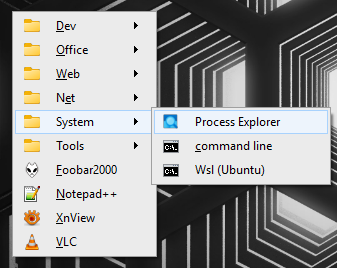
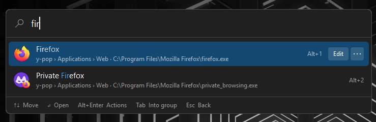

# y-pop

**Your programs, one keystroke away.** y-pop puts your launchers in the
notification area: tray menus you organise yourself, hotkeys that open a menu or
start one program, and a search window that finds them as you type.

| | |
| --- | --- |
|  |  |
| Popup menu mode | Search mode |

<!-- Add once recorded, see docs/design/media-shots.md:

-->

## Why y-pop

- **Light.** One native executable of about 650 KB. No runtime, no DLL plugins,
  no background service.
- **Yours.** The menus hold what you put in them, in the order you want, and one
  small file describes them all.
- **Fast from the keyboard, fine with the mouse.** Menus and search work both
  ways, and the search window opens with your last program already selected:
  *hotkey, then Enter* starts it again.
- **Portable.** Drop `y-pop.xml` next to `y-pop.exe` and the whole thing fits on
  a USB stick.

## Find it by typing

Press a hotkey, type a few letters, press `Enter`.

- **Fuzzy matching**: `out` finds *Open Utility Tool* by its initials, and a word
  also matches keywords you added, file names, groups and tooltips.
- **Recent**, straight from Windows's own history, so it knows what you opened
  anywhere, and what you use most rises in the results.
- **Quick pick**: `Alt+1` to `Alt+9` open a result without moving to it.
- **Actions on any result**: run as administrator, show in folder, copy the path,
  reveal it in its tray menu, edit it in the settings.
- **Browse instead of searching**: walk your menus in columns with a details
  pane, or read every app in one A–Z list.
- **Prefixes**: `>` for y-pop's own commands, `/` for the files inside your
  folders, `#` for your hotkeys.
- **Is this key free?** Type `#ctrl+alt+x` and y-pop tells you whether Windows or
  another program holds it, before you assign it.

<!-- Add once recorded:


-->

## Menus that hold everything

- **As many tray icons as you like**, each with its own menu of submenus,
  separators, titles and columns.
- **Anything can be launched**: programs, documents, folders, addresses and Store
  apps, as administrator if you wish, with your own arguments and working folder.
- **Live folders**: a menu can list a folder, filtered by extension and as deep as
  you want. It is read when you open it, so a new file is simply there.
- **Hotkeys on anything**: open a menu at the pointer, or start one item directly.
  A key another program holds can be claimed, if you ask for it.
- **Variables**: `%tools%\backup.bat` keeps paths in one place, and `%clipboard%`
  passes what you just copied to the program you start.
- **Start and exit events**: run a program when y-pop starts or quits.

## Your colours

Seven themes, or `auto` to follow Windows's light or dark setting: plain Windows
menus, PortAL's three originals, and *graphite*, *midnight* and *sand*. A few
lines of `<skin>` change colours, gradients, borders and corners, for the menus
and for the search window separately.

<!-- Add once taken:

-->

## Set it up your way

Use **y-pop-config**, the settings app, or write the file by hand. This is a
complete `y-pop.xml`:

```xml
<y-pop theme="auto">
	<search hotkey="Alt+Space"/>
	<group name="Work">
		<hotkey key="Win+Y"/>
		<app name="Notepad" exe="%win%\notepad.exe"/>
		<app name="Documents" exe="%mydocs%" browse="true" depth="1"/>
		<separator/>
		<settings/>
		<quit/>
	</group>
</y-pop>
```


An unknown attribute or a bad key combination costs you that one setting: y-pop
warns about it and loads the rest. A reload that fails keeps what is already
running, so a half-typed edit never takes your hotkeys away.

## Get it

y-pop runs on Windows 10 and 11 (x64). The
[main page](../README.md#install) has the installer and the portable zip. The
default configuration has a menu on `Win+Y`; add a `<search>` line like the one
above to get the search window.

## Documentation

| | |
| --- | --- |
| [User manual](docs/user-manual.md) | using the search window: keys, prefixes, sections, actions, and everything inside `<search>` |
| [Configuration reference](docs/configuration.md) | every setting of `y-pop.xml` outside `<search>`: tray icons, items, hotkeys, variables, themes and skins |
| [Settings app](../y-pop-config/docs/user-manual.md) | using y-pop-config: every page, the app picker, drag and drop, the skin |
| [Development](docs/development.md) | how the code is organised, and the design notes |

y-pop is the Rust rewrite of [PortAL](http://glatigny.github.io/guipro/), part of
[Ypo-Lite](../README.md). It does not read `portal.xml` files: the schema is new.
