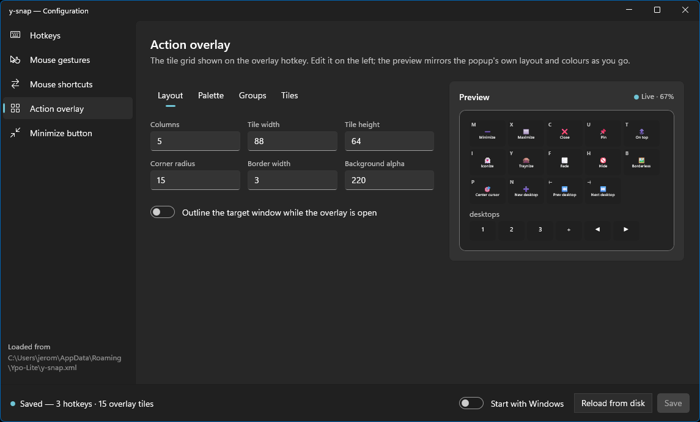

# Y-Snap-config

The settings app of [Y-Snap](../y-snap/README.md): a WinUI 3 editor for
`y-snap.xml`. Hotkeys, mouse gestures and shortcuts, the action overlay and the
minimize-button popup, each with a live preview where there is something to see.
When you save, a running y-snap applies the change at once.



## Use it

Double-click y-snap's tray icon, or choose **Settings…** in its menu.
`y-snap-config.exe` sits next to `y-snap.exe`; only one window opens at a time.

Saving rewrites `y-snap.xml`, so comments in the file are not kept. To keep notes
in it, edit the file by hand instead.

## Documentation

| | |
| --- | --- |
| [User manual](docs/user-manual.md) | every page of the app, with screenshots |
| [Configuration reference](../y-snap/docs/configuration.md) | every setting of `y-snap.xml` |
| [`design/`](docs/design/) | roadmap, UI checklist and mockup |
| [UI toolkit](../ui-kit/docs/ui-toolkit.md) | the shared `ui-kit` the screens are built from |

## Build

```sh
cargo run -p y-snap-config
```

Built on [`windows-reactor`](../docs/design/windows-reactor.md) and `ui-kit`, part of
[Ypo-Lite](../README.md).
