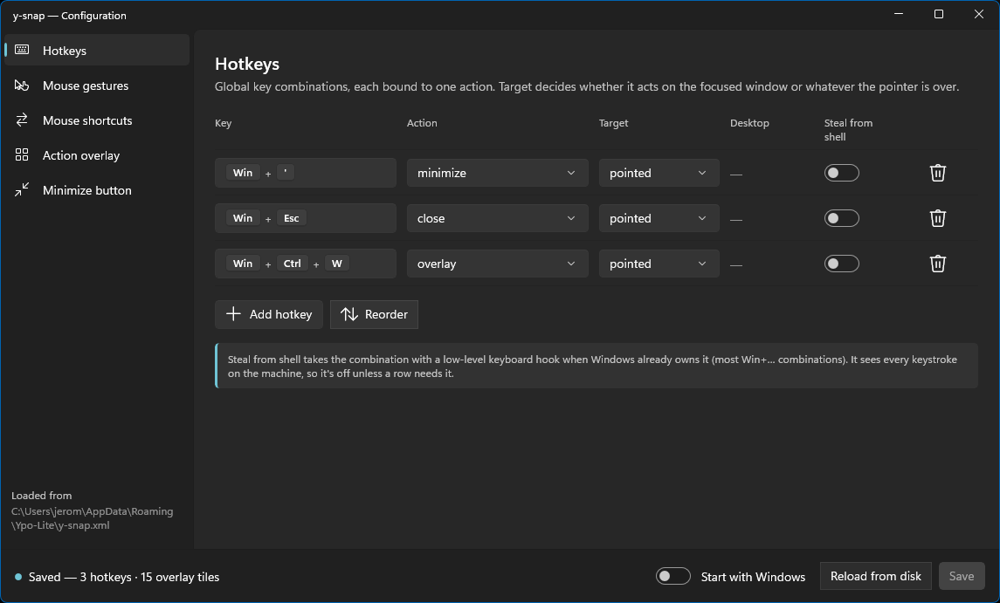
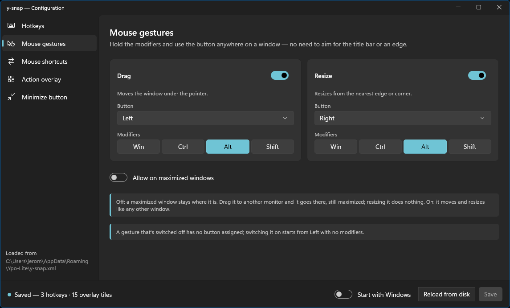
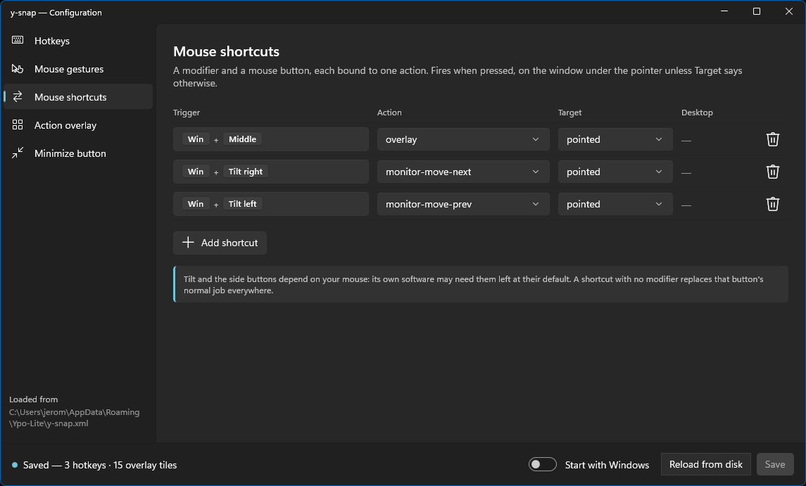
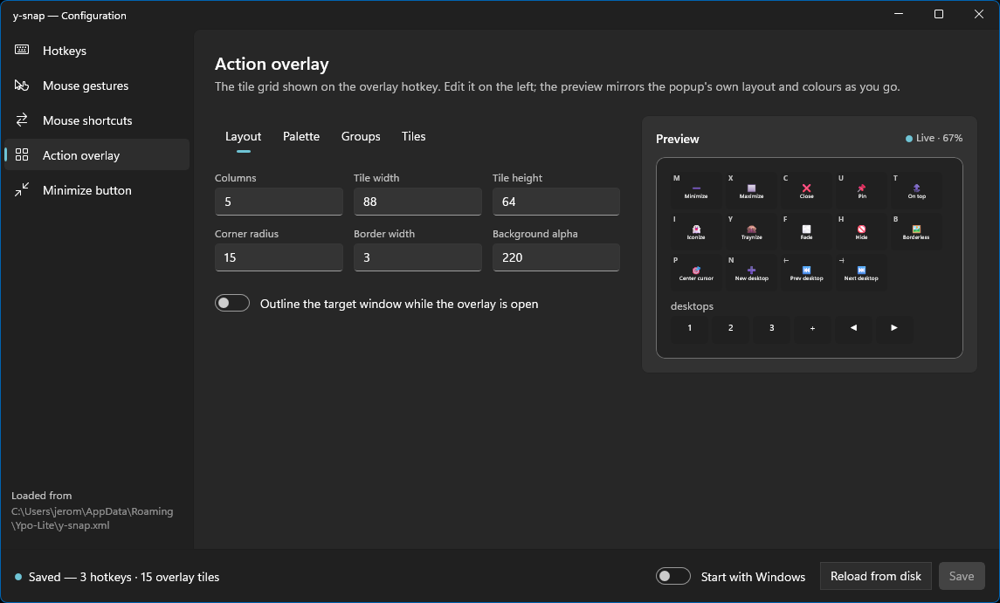
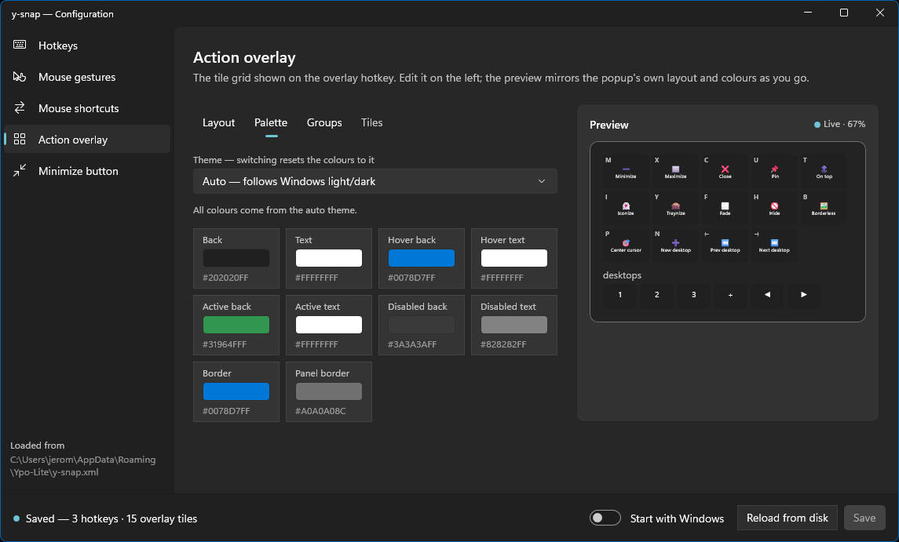
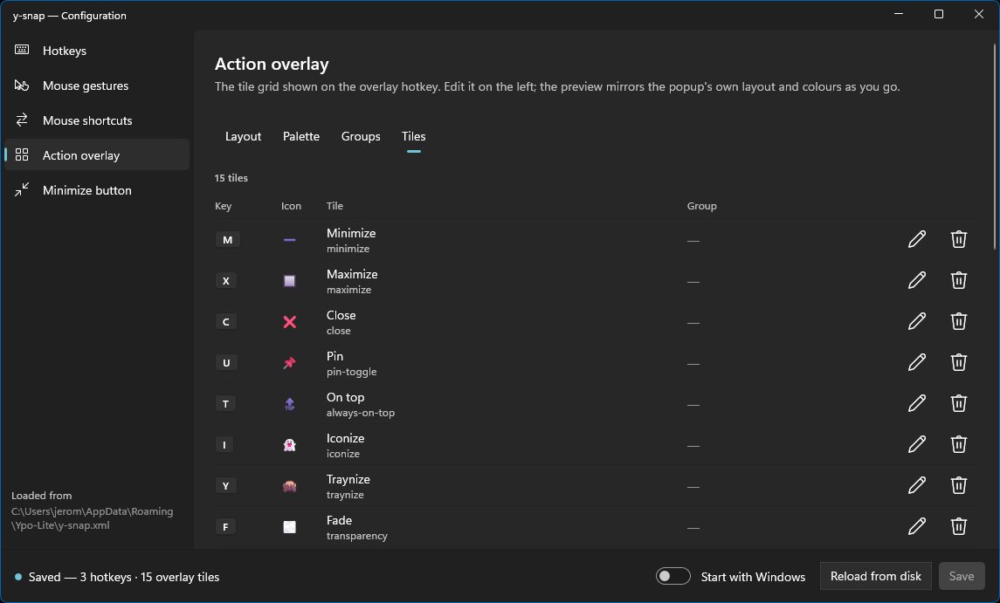
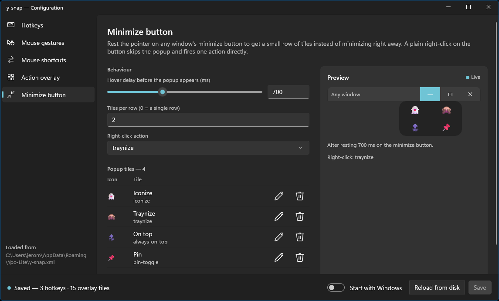

# y-snap-config — user manual

y-snap-config is the settings app of [y-snap](../../y-snap/README.md). It edits
`y-snap.xml` for you: hotkeys, mouse gestures and shortcuts, the action overlay and
the minimize-button popup, with a live preview where there is something to see.
When you save, a running y-snap applies the change at once.

Everything the app edits is also in the file, and the
[configuration reference](../../y-snap/docs/configuration.md) describes it attribute
by attribute. This manual is about the app.

- [Opening it](#opening-it)
- [The window](#the-window)
- [Hotkeys](#hotkeys)
- [Mouse gestures](#mouse-gestures)
- [Mouse shortcuts](#mouse-shortcuts)
- [Action overlay](#action-overlay)
- [Minimize button](#minimize-button)
- [Saving, and what is kept](#saving-and-what-is-kept)
- [Troubleshooting](#troubleshooting)

---

## Opening it

Double-click y-snap's tray icon, or right-click it and choose **Settings…**. The
app is `y-snap-config.exe`, in the same folder as `y-snap.exe`; you can also start
it on its own, with or without y-snap running.

Only one window is ever open: starting it again brings the open one forward, so two
editors never overwrite each other's saves.

---

## The window

- **The list on the left** has one page for each part of y-snap. Below the list,
  *Loaded from* shows which `y-snap.xml` is being edited: the one in
  `%APPDATA%\Ypo-Lite`, or the one next to `y-snap.exe` for a portable copy.
  The list shrinks to icons when the window is narrow.
- **The status bar at the bottom** says what state the file is in: *Saved*, or
  *Unsaved changes*, with a count of hotkeys and overlay tiles. Its buttons:
  - **Start with Windows** registers y-snap to start when you sign in. It applies
    at once, and does not wait for Save.
  - **Reload from disk** reads `y-snap.xml` again.
  - **Save** is available once something has changed.
- **Warnings.** If the file has things y-snap could not understand, such as an
  unknown action or a key that does not parse, a banner above the page lists them.
  y-snap ignores those entries, and saving removes them from the file. The status
  bar turns red and says how many before you save.

Rows with a key to set, an action to choose and so on are edited in place. A key
combination, a mouse trigger or an icon opens its picker right under the row.

---

## Hotkeys

Global key combinations, each bound to one action. See
[the user manual](../../y-snap/docs/user-manual.md#first-steps) for the defaults.

| Column | |
| --- | --- |
| **Key** | Click it to choose a combination. The picker lists every key by category (letters, function keys including `F13`–`F24`, media keys…) and has a search box. |
| **Action** | What the combination does. |
| **Target** | `pointed` acts on the window under the pointer, `focused` on the window that has the keyboard focus. |
| **Desktop** | The virtual desktop number, for the actions that need one, such as sending a window to a desktop. A dash means the action takes none. |
| **Steal from shell** | Takes the combination with a low-level keyboard hook when Windows already owns it (most `Win+…` combinations). The hook sees every keystroke on the machine, so leave it off unless a row needs it. |

**Add hotkey** adds a row and opens its key picker. **Reorder** swaps each row's
buttons for ↑ and ↓. The trash button deletes a row.

---

## Mouse gestures

Move and resize a window from anywhere inside it. *Drag* and *Resize* each have a
switch, a **Button** (left, middle or right) and **Modifiers** (`Win`, `Ctrl`, `Alt`,
`Shift`, any number of them). The defaults are `Alt` with the left button to move
and `Alt` with the right button to resize.

A gesture that is switched off has no button; switching it on again starts from
the left button and no modifiers.

**Allow on maximized windows** is off by default: a maximized window stays where it
is. When it is on, dragging a maximized window moves it, and resizing it works like
on any other window.

---

## Mouse shortcuts

A modifier plus a mouse button, a side button or a wheel tilt, bound to any action,
on the window under the pointer unless **Target** says otherwise. There are none by
default.

**Add shortcut** adds one and opens its editor. The editor offers every trigger
once, in three groups: **Button** (left, middle, right), **Wheel tilt** (left,
right) and **Side button** (back, forward), above the **Modifiers**. The trigger you
chose is the highlighted one.

- A combination that y-snap would refuse, such as one that clashes with the Drag
  or Resize gesture, is flagged in the editor. *Done* stays disabled and Save
  refuses to save until it is fixed.
- A trigger without a modifier says what it replaces: *Replaces middle click
  everywhere.*
- Tilt and the side buttons depend on your mouse. Its own software may need them
  left at their default setting.

There is no *Reorder* here: order means nothing, since the same combination cannot
be used twice.

---

## Action overlay

The popup of tiles that `Ctrl+Space` opens over a window. The page has four tabs
and a preview that follows every change you make, scaled down to fit when the window
is small.

### Layout

The number of **Columns**, the **Tile width** and **Tile height**, the **Corner
radius**, the **Border width** and the **Background alpha** (255 is opaque). The
switch **Outline the target window while the overlay is open** draws the coloured
outline around the window an action will apply to.

### Palette

Pick a **Theme**: *Auto* follows the Windows light or dark mode, *Light* and *Dark*
are fixed. Choosing a theme resets every colour to it.

Below are the ten colours: *Back*, *Text*, *Hover back*, *Hover text*, *Active
back*, *Active text*, *Disabled back*, *Disabled text*, *Border* and *Panel border*.
Click one to change it. Only the colours you changed are written to the file, along
with the theme, so an *Auto* overlay keeps following Windows. A note counts the
colours you changed, with a button to put them back.

### Groups

A group is a row of tiles of its own, with its own number of columns and its own tile
size, such as the `desktops` row in the screenshots. Tiles join a group on the Tiles
tab. **Add group** adds one, and **Reorder** orders them.

### Tiles

One row per tile: its **Key**, **Icon**, label and action, and its **Group**. The
pencil opens the tile's editor under the row, the trash button deletes it. **Add
tile** adds one and opens it.

In the editor:

- **Action** is what the tile does.
- **Key** is the key that triggers it while the overlay is open.
- **Label** is shown under the icon.
- **Icon** is an emoji or a glyph. The picker suggests icons for the chosen action
  and has a search box and categories. To use any other emoji, click in the Icon box
  and press `Win` + `.`. Choosing an action fills in a suggested icon, unless you
  picked one yourself.
- **Group** puts the tile in one of your groups.
- **Desktop** is the desktop number, for actions that take one. A *desktop list*
  tile has no key of its own: it turns into one tile per virtual desktop, keyed
  `1`, `2`, `3`…

---

## Minimize button

What happens when you rest the pointer on a window's minimize button.

- **Hover delay before the popup appears (ms)**: a slider and a box, to set it by
  feel or exactly.
- **Tiles per row**: `0` puts every tile in a single row.
- **Right-click action**: what a right click on the button does, instead of the
  popup. *none* turns it off.
- **Popup tiles**: the tiles the popup shows, edited like the overlay's. Only
  actions that make sense on a window you point at are offered. A tile shows its
  icon, and its label only when it has no icon.

The preview shows the popup under a minimize button, with your delay and your
right-click action.

---

## Saving, and what is kept

**Save** writes `y-snap.xml`, then asks a running y-snap to reload it. The status bar
tells you which it was:

- *Saved and applied: y-snap is reloading it*;
- *Saved: y-snap isn't running; it'll use these settings when it starts*.

If y-snap finds a problem in what you saved, it says so in its own notification.

**The file is rewritten, not patched.** Comments, indentation and the order of
attributes in `y-snap.xml` are not kept, and things y-snap could not read are
dropped. If you keep notes in the file, edit it by hand
(**Configuration → Edit y-snap.xml** in the tray menu) and use *Reload
configuration* afterwards instead of saving from the app.

A theme stays a theme: an overlay set to `auto` is saved as `auto`, not as the ten
colours it looked like when the file was read.

---

## Troubleshooting

**The app says it couldn't load `y-snap.xml`.** The file is not valid XML, such as a
tag left open. The message gives the line. Fix it with **Edit y-snap.xml**, or
delete it: with no file, *Save* creates one.

**I saved and nothing changed in y-snap.** The status bar says whether y-snap was
running. If it was, check its tray menu: a file it could not load shows there.
y-snap running as administrator does not receive the reload request; restart it.

**A combination is refused, or does nothing.** Windows owns most `Win+…`
combinations. Turn on **Steal from shell** for that row, knowing what it costs.
Some combinations, such as `Ctrl+Alt+Del`, cannot be taken by any program.

**My mouse's side buttons or tilt do nothing.** The mouse's own software may be
using them. Reset them to their default function there.

**A row of my file is gone after saving.** It was one y-snap could not read, listed in
the warnings banner before you saved. Look there before saving next time.
